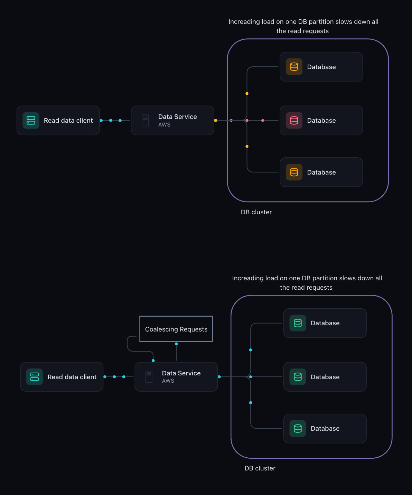
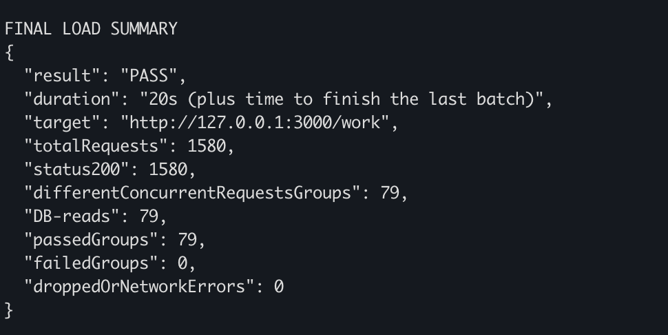

# Request coalescing POC

This POC shows how multiple overlapping requests for the same query can share
one database read instead of repeating identical work.

## The problem

Imagine a popular chat channel immediately after an announcement. Many users
open the same message page at almost the same time. Every request needs the
same data, but a basic implementation starts a separate database read for each
request.

If a read takes 250 ms and 20 identical requests arrive while it is running,
that implementation performs 20 reads for the same result. This duplicate work
increases database load and can become a bottleneck as traffic grows.

## What we are solving

We want one backing read for each group of overlapping, identical requests.
Every caller still receives a response, but callers share the work needed to
produce it. This technique is called **request coalescing**, or **single-flight**.

In this POC, a database read is simulated with a 250 ms timer. There is no real
database to install or configure.

## Flow diagram

The diagram compares repeated reads reaching the database directly with a data
service that coalesces overlapping identical requests before querying storage.
The database cluster illustrates the wider system; this POC simulates the read
inside a single Node.js process.



## How the solution works

The implementation is in `starter/lab.mjs`:

1. Identify the query using the request pathname and `key` parameter.
2. If that query has no pending read, increment `reads`, register the first
   caller and start `dbCall()`.
3. If the same query is already pending, add the caller to its waiting list.
   Do not start another read.
4. When the read completes, resolve every waiting caller with its result.
5. Delete the waiting list so a later request starts a fresh read.

For example, 20 overlapping requests for `/work` share one read and receive
20 responses. After that read finishes, the next group starts a new read.

This is **in-flight sharing**, not a result cache: completed results are not kept
for future requests.

## Run

Requires Node.js 22+ and k6. No npm packages or database setup.

Terminal 1, from the project root:

```bash
cd starter
node server.mjs
```

Terminal 2, also inside `starter/`:

```bash
k6 run load.js
```

Restart the server after changing `lab.mjs`.
The default endpoint is `GET /work?key=org-a/channel-1/page-1`.
Calling `/work` without a key uses that same default query.

For another port, run these in separate terminals inside `starter/`:

```bash
PORT=3001 node server.mjs
```

```bash
k6 run -e TARGET=http://127.0.0.1:3001/work load.js
```

## What the load test checks

`starter/load.js` runs for 20 seconds. One k6 coordinator sends a batch of
20 parallel requests, waits for all of them to finish, then starts the next batch.
These batches are the separate concurrent request groups in the summary.
Requests already running at 20 seconds can finish before the test exits.

For each group, the script reads `GET /__metrics` before and after the batch.
A group passes only if:

- All 20 requests return HTTP 200.
- The database-read counter increases by exactly one.

Each group logs PASS or FAIL, followed by a final summary. Any failed group makes
k6 exit nonzero. Metrics requests are excluded from workload totals. Run against
an idle server without other clients so counter changes belong to this test.

## Result

The captured run passed with **1,580 successful requests across 79 groups and
79 simulated database reads**. All groups passed, with no dropped responses or
network errors reported.



Each group served 20 requests using one read. Compared with a one-read-per-request
implementation under this same workload, that is **95% fewer backing reads**:
79 rather than 1,580. This comparison describes read counts; it does not measure
a real database's performance.

The summary fields mean:

- `result`: PASS when at least one group ran and no groups failed.
- `duration`: the configured workload duration, plus time for the last batch to finish.
- `target`: the endpoint under test.
- `totalRequests`: the number of completed workload requests, including errors.
- `status200`: the number of HTTP 200 responses.
- `differentConcurrentRequestsGroups`: the number of separate batches.
- `DB-reads`: the number of simulated backing reads started during the batches.
- `passedGroups` / `failedGroups`: batches that met or failed the checks above.
- `droppedOrNetworkErrors`: requests with no HTTP response, including connection
  drops and timeouts. Other HTTP statuses appear in failed-group logs.

The exact number of groups can vary between runs because of scheduling and
request overhead. The invariant is one backing read per successful group.

## Files

- `starter/lab.mjs`: coalescing solution, simulated database read and read counter.
- `starter/server.mjs`: HTTP server and metrics endpoint.
- `starter/load.js`: workload, correctness checks and console results.
- `docs/load-test-result.png`: screenshot of the captured result.
- `docs/request-coalescing-flow.gif`: animated architecture flow diagram.

## Scope

This POC demonstrates successful overlapping reads in a single Node.js process
for one synthetic query. It does not implement a real database, authorization,
distributed coordination or persistent caching. The load result does not verify
shared failure recovery, cancellation or isolation across multiple query scopes.
